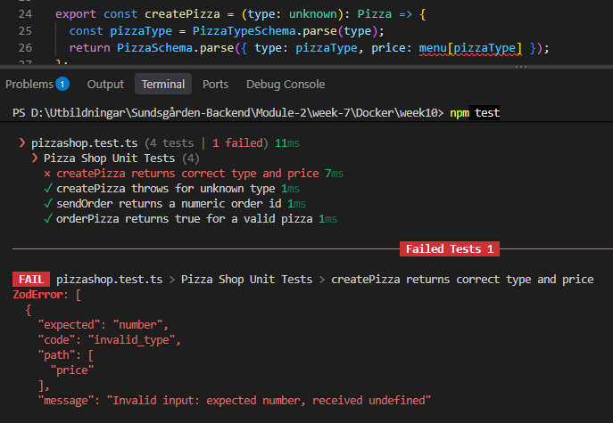

# Q&A
## 1. Which schema stoped the test run
It seems the tests are running the zod schemas before the typescript checks are performed, otherwise we would run into typescript errors. But, as the image shows us, the first error cought is a ZodError.  

## 2. Which file does the test "orderPizza("vegetarian") belong in?"
It belongs in the test file for unit tests (**pizzashop.test.ts**), because it only tests one thing.