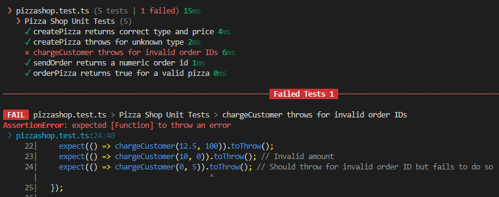

# Q&A
## 1. Which schema stoped the test run
It seems the tests are running the zod schemas before the typescript checks are performed, otherwise we would run into typescript errors. But, as the image shows us, the first error cought is a ZodError.  

## 2. Which file does the test "orderPizza("vegetarian") belong in?"
It belongs in the test file for unit tests (**pizzashop.test.ts**), because it only tests one thing.

## 3. The BUG

  
The cause of the bug is zod's interpretation of **nonnegative()**. It means “zero or greater”, so 0 passes validation, never throws as expected and hence the AssertionError (why the 0 amount assertion fails to throw). The test treats 0 as an invalid order ID, so we need “greater than zero” instead, which is zod's **positive()** method, (see AmountSchema also)